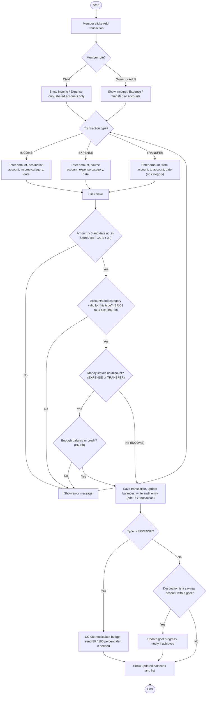

# Activity Diagram — Record a Transaction (UC-04 / UC-05)

Author: Nuray Mukhambet — Systems Analysis & Requirements

Shows how one form handles all three transaction types and where each business rule is checked.

