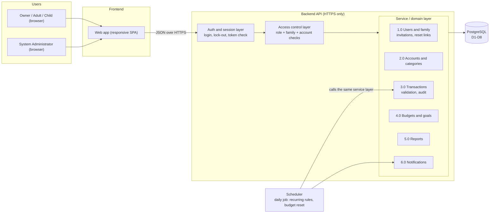

# System Architecture Diagram

Author: Nuradin Alinur — Architecture & Security · Details: [../10-architecture-and-security.md](../10-architecture-and-security.md)

The boundaries come from the DFD level 1: each process (1.0–6.0) becomes a module of the backend, and each data store (D1–D8) lives in PostgreSQL.

| Boundary | Rule |
|---|---|
| Browser ↔ Backend | HTTPS only (NFR-04). The browser is never trusted: every rule is checked again on the server (NFR-02). |
| Backend ↔ Database | Only the service layer talks to PostgreSQL. Saving a transaction and its audit entry happen in one DB transaction (NFR-09). |
| Scheduler ↔ Backend | The scheduler does not write to tables on its own. It calls the same service functions as the API, so BR-08 and the audit log apply to recurring transactions too (BR-26). |
