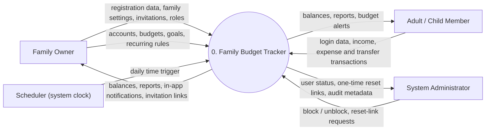

# Context Diagram (DFD Level 0)

Author: Nuray Mukhambet — Systems Analysis & Requirements

The whole system is one process. There is no email service: all notifications are in-app (decision D-3). The diagram shows the external entities and the data that flows between them and the system.

