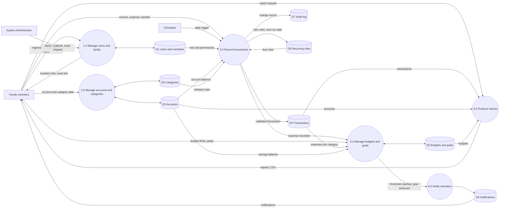

# Data Flow Diagram — Level 1

Author: Nuray Mukhambet — Systems Analysis & Requirements

Process 0 from the context diagram is split into six main processes. Cylinders are data stores.

| Process | Description | Main requirements |
|---|---|---|
| 1.0 | Registration, login, family creation, invitation links, roles, blocking, admin password reset | FR-01 – FR-09, FR-39 |
| 2.0 | Accounts (create, archive, share) and categories | FR-10 – FR-15 |
| 3.0 | Validate and save INCOME / EXPENSE / TRANSFER, run recurring rules, write audit | FR-16 – FR-23, FR-37 |
| 4.0 | Budgets, spent calculation, alerts, savings goals | FR-24 – FR-29 |
| 5.0 | Summary, category, member and balance reports, CSV export | FR-30 – FR-34 |
| 6.0 | Create and show in-app notifications | FR-35 |
