# Entity-Relationship Diagram (logical)

Author: Nuray Mukhambet — Systems Analysis & Requirements · Full attribute list: [../07-data-dictionary.md](../07-data-dictionary.md)

Note that `TRANSACTION` has **two** optional links to `ACCOUNT` (source and destination). This is what lets one table hold income (destination only), expenses (source only) and transfers (both).

```mermaid
erDiagram
    USER ||--o| FAMILY_MEMBER : "is"
    FAMILY ||--|{ FAMILY_MEMBER : "has"
    FAMILY ||--o{ INVITATION : "sends"
    FAMILY ||--o{ ACCOUNT : "owns"
    FAMILY ||--o{ CATEGORY : "defines"
    FAMILY ||--o{ TRANSACTION : "contains"
    FAMILY ||--o{ BUDGET : "plans"
    FAMILY ||--o{ SAVINGS_GOAL : "sets"
    FAMILY ||--o{ RECURRING_RULE : "schedules"
    FAMILY |o--o{ AUDIT_LOG : "is logged in"

    ACCOUNT |o--o{ TRANSACTION : "source of"
    ACCOUNT |o--o{ TRANSACTION : "destination of"
    CATEGORY |o--o{ TRANSACTION : "classifies"
    CATEGORY |o--o{ CATEGORY : "parent of"
    CATEGORY ||--o{ BUDGET : "limited by"
    ACCOUNT ||--o| SAVINGS_GOAL : "funds"
    ACCOUNT ||--o{ ACCOUNT_ACCESS : "shared via"
    FAMILY_MEMBER ||--o{ ACCOUNT_ACCESS : "gets"
    FAMILY_MEMBER ||--o{ TRANSACTION : "records"
    FAMILY_MEMBER ||--o{ NOTIFICATION : "receives"
    RECURRING_RULE |o--o{ TRANSACTION : "generates"
    USER ||--o{ AUDIT_LOG : "performs"

    USER {
        int user_id PK
        string email UK
        string password_hash
        string full_name
        boolean is_active
        boolean is_system_admin
    }
    FAMILY {
        int family_id PK
        string name
        string base_currency "default KZT"
    }
    FAMILY_MEMBER {
        int member_id PK
        int family_id FK
        int user_id FK, UK
        string role "OWNER, ADULT, CHILD"
    }
    INVITATION {
        int invitation_id PK
        int family_id FK
        string email
        string role "ADULT, CHILD"
        string status "PENDING, ACCEPTED, DECLINED, EXPIRED"
        datetime expires_at
    }
    ACCOUNT {
        int account_id PK
        int family_id FK
        string name
        string type "CASH, BANK_CARD, SAVINGS, CREDIT_CARD"
        decimal opening_balance
        decimal credit_limit
        boolean is_archived
    }
    ACCOUNT_ACCESS {
        int account_id PK, FK
        int member_id PK, FK
    }
    CATEGORY {
        int category_id PK
        int family_id FK "null = default"
        int parent_id FK
        string name
        string type "INCOME, EXPENSE"
    }
    TRANSACTION {
        int transaction_id PK
        int family_id FK
        string type "INCOME, EXPENSE, TRANSFER"
        decimal amount "always > 0"
        int source_account_id FK "null for INCOME"
        int destination_account_id FK "null for EXPENSE"
        int category_id FK "null for TRANSFER"
        date transaction_date
        int created_by FK
        int recurring_rule_id FK
        boolean is_deleted
    }
    RECURRING_RULE {
        int rule_id PK
        int family_id FK
        string type "INCOME, EXPENSE, TRANSFER"
        decimal amount
        string frequency "WEEKLY, MONTHLY, YEARLY"
        date next_run_date
        boolean is_active
    }
    BUDGET {
        int budget_id PK
        int family_id FK
        int category_id FK "EXPENSE only"
        date period_month
        decimal limit_amount
    }
    SAVINGS_GOAL {
        int goal_id PK
        int account_id FK, UK
        string name
        decimal target_amount
        string status "ACTIVE, ACHIEVED, CANCELLED"
    }
    NOTIFICATION {
        int notification_id PK
        int member_id FK
        string type
        string message
        boolean is_read
    }
    AUDIT_LOG {
        int log_id PK
        int family_id FK
        int actor_user_id FK
        string entity_type
        string action
        json old_value
        json new_value
    }
```

