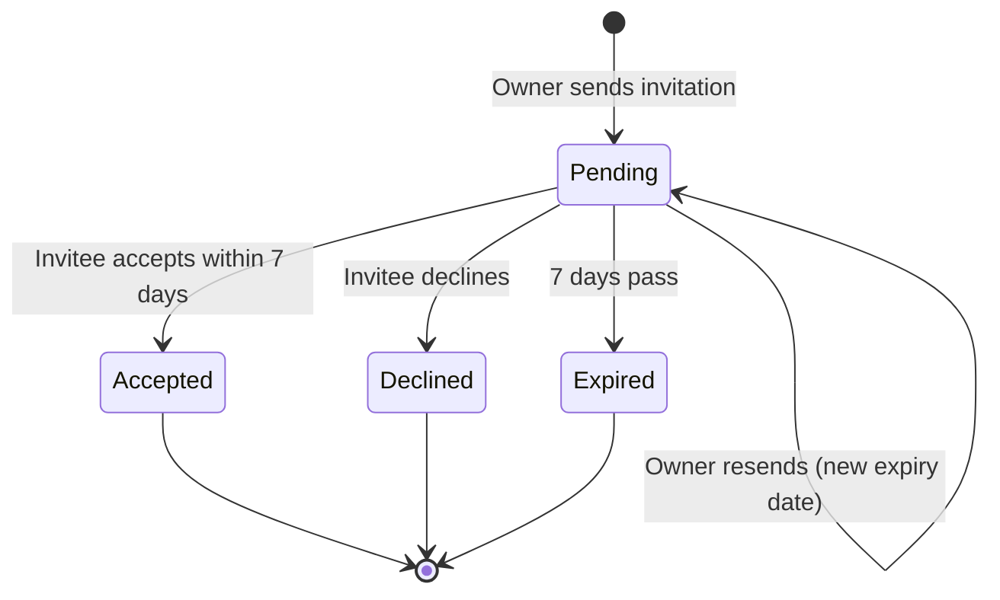
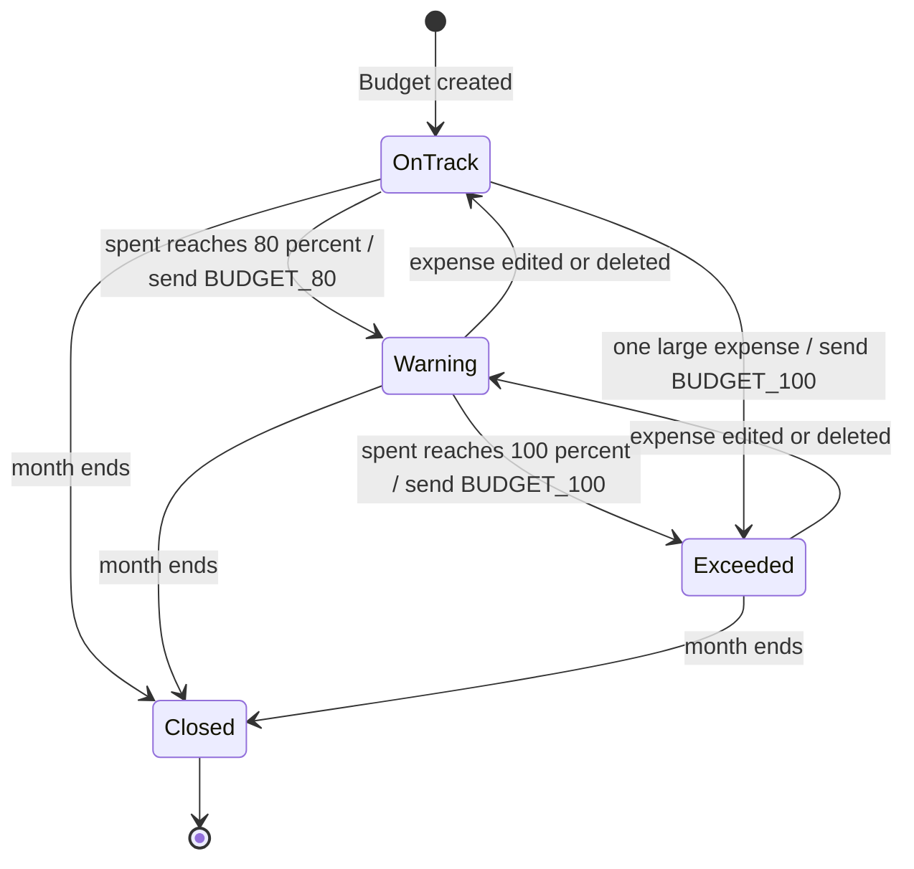
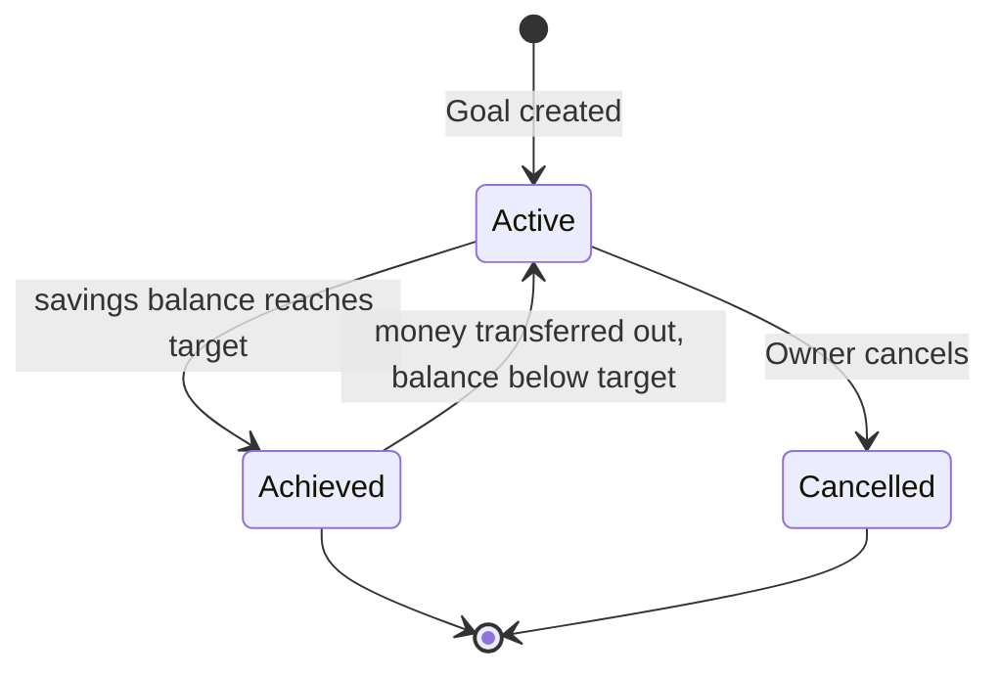

# State Diagrams

Author: Nuray Mukhambet — Systems Analysis & Requirements

## Invitation (FR-06, FR-07, BR-19)

## Budget for one month (FR-25, FR-26, BR-16)

## Savings goal (FR-28, FR-29, BR-25)

