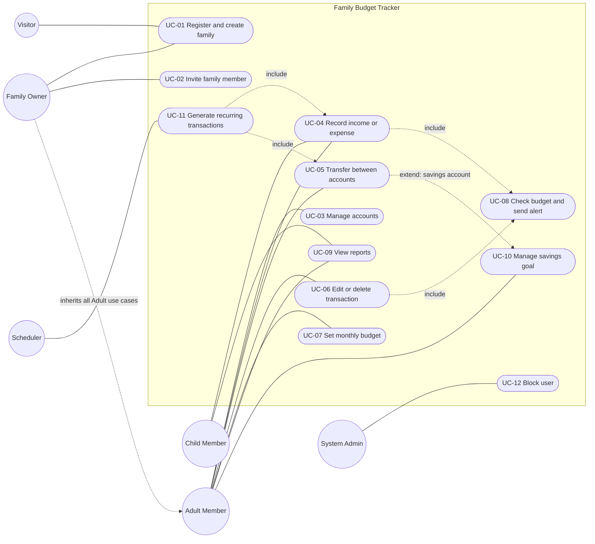

# Use Case Diagram

Author: Nuray Mukhambet — Systems Analysis & Requirements · Details of each use case: [../04-use-cases.md](../04-use-cases.md)

**Reading the diagram**
- *Family Owner* is a specialisation of *Adult Member*: the Owner can do everything an Adult can, plus UC-01 and UC-02 (and owner-only steps inside UC-03).
- *Child Member* has only UC-04 (restricted to shared accounts, no transfers) and UC-09 (own data).
- UC-08 is never started by a person; it is **included** every time an expense is created, edited or deleted.
